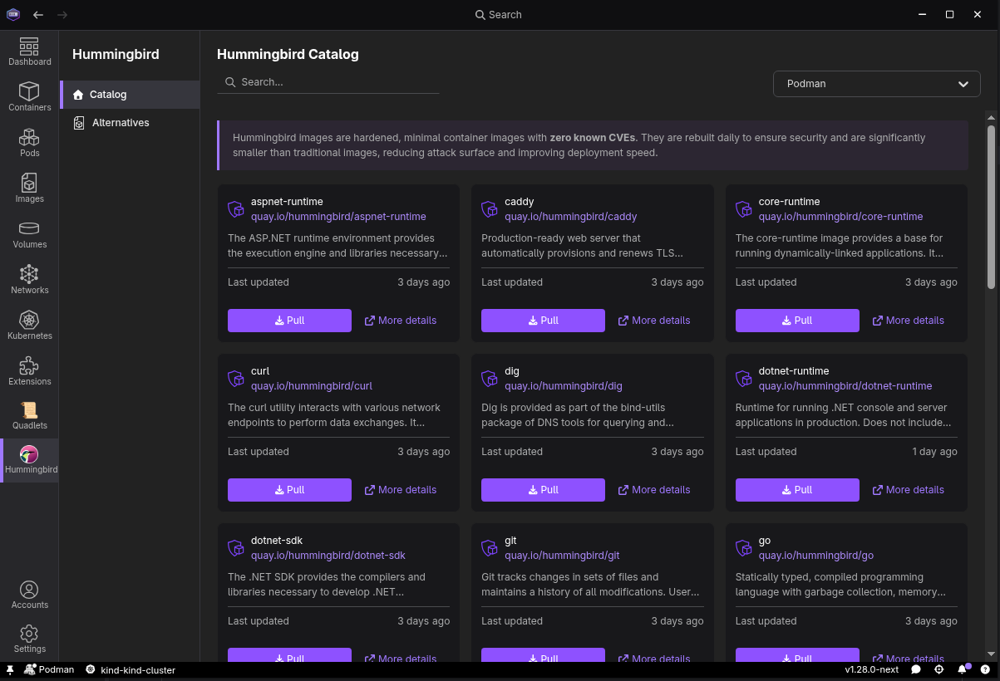
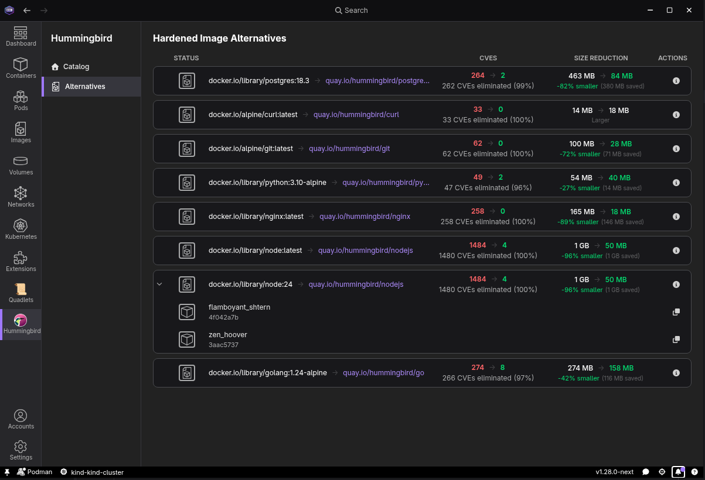
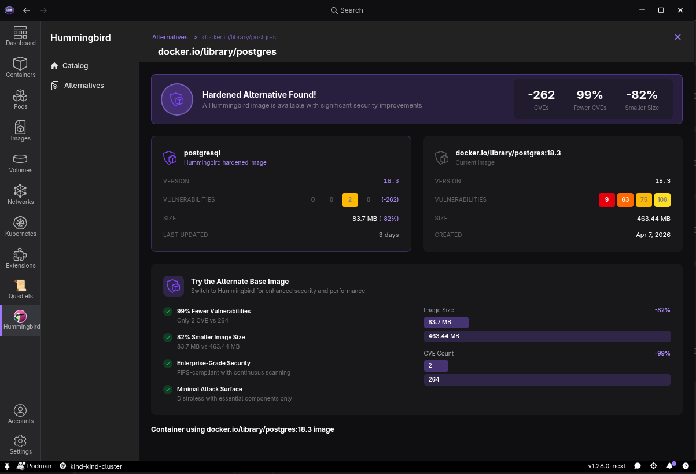
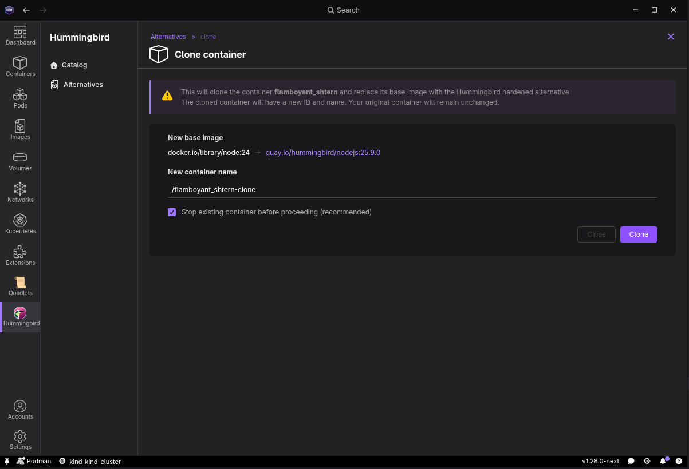

# Hummingbird Extension for Podman Desktop

This extension integrates the [Hummingbird project](https://hummingbird-project.io/) hardened images to Podman Desktop.

## Features

### Hummingbird Catalog

The Podman Desktop Hummingbird extension allows you to directly list the Hummingbird hardened images
from within Podman Desktop and pull them.



### Alternative page

As the extension is integrated in Podman Desktop, it can scan your local registry and directly suggest alternative
images. 

Combined with the [Grype](https://github.com/podman-desktop/extension-grype) extension, you will be able to compare the
image and their alternatives, comparing image size and number of CVEs.



You can get detailed insight on the alternative and the base image in the dedicated details page



### Cloning

Listing image is great, but we also detect the containers that are using an image with a hardened alternative.
From the Hummingbird extension, you can take an existing container and clone its config to use with a Hummingbird image.



## End-to-end tests

The Playwright suite installs the Hummingbird extension, checks that it is active, verifies its details page, and removes
it during cleanup. It uses `@podman-desktop/tests-playwright` and an isolated Podman Desktop profile.
CI refreshes the framework to `@next` to match Podman Desktop `main`, regardless of the version pinned in
`tests/playwright/package.json`.

CI installs a Podman Desktop production binary via the shared `podman-desktop-install` action. Locally you can either
point at a Podman Desktop checkout or a packaged binary:

```sh
pnpm install --frozen-lockfile
pnpm --dir tests/playwright exec playwright install chromium
PODMAN_DESKTOP_BINARY=/path/to/podman-desktop pnpm test:e2e --grep @installation
```

Or build from a Podman Desktop source checkout:

```sh
cd /path/to/podman-desktop
pnpm install --frozen-lockfile
pnpm test:e2e:build
cd /path/to/podman-desktop-hummingbird-ext
PODMAN_DESKTOP_ARGS=/path/to/podman-desktop pnpm test:e2e --grep @installation
```

On Windows, set `$env:PODMAN_DESKTOP_ARGS` or `$env:PODMAN_DESKTOP_BINARY` in PowerShell before running the tests.
On Linux, install Xvfb and Playwright's system dependencies with
`pnpm --dir tests/playwright exec playwright install --with-deps chromium`.
Set only one of `PODMAN_DESKTOP_BINARY` / `PODMAN_DESKTOP_ARGS`.

The default image is `ghcr.io/redhat-developer/podman-desktop-hummingbird-ext:next`. Set `OCI_IMAGE` to test another
published image. Run `pnpm test:e2e` to execute the full suite. Reports, traces, and videos are written under
`tests/playwright/tests/output/`; Playwright's per-test artifacts are under `tests/playwright/output/`.

### Test a local container image

PR checks build the repository's `Containerfile`, export `/extension`, and preload it into the test profile (same pattern
as [quadlet](https://github.com/podman-desktop/extension-podman-quadlet/blob/main/.github/workflows/e2e.yaml) /
[grype](https://github.com/podman-desktop/extension-grype/blob/main/.github/workflows/e2e.yaml)). To reproduce locally
with Podman running:

```sh
podman build -t localhost/local_image ./
container_id=$(podman create --entrypoint /bin/true localhost/local_image)
mkdir -p tests/playwright/tests/output/hummingbird-tests-pd/plugins
podman export "$container_id" | tar -x -C tests/playwright/tests/output/hummingbird-tests-pd/plugins
podman rm "$container_id"
SKIP_INSTALLATION=true SKIP_REMOVE_FOLDER=true PODMAN_DESKTOP_BINARY=/path/to/podman-desktop pnpm test:e2e --grep @installation
```

`SKIP_INSTALLATION=true` skips the registry installation step, and `SKIP_REMOVE_FOLDER=true` preserves the preloaded
profile while still running the framework's global setup (Chromium install). Activation and details checks still run
and fail if the local extension is missing or cannot activate. Cleanup removes the extension, so export it again
before another run.

### CI workflows

- `pr-check.yaml` calls reusable `e2e.yaml` to build and preload the local OCI image, install Podman
  Desktop via `podman-desktop/gh-extensions-actions`, and run the installation smoke tests on GitHub-hosted
  `ubuntu-26.04` and `windows-2025` runners (same matrix pattern as
  [extension-podman-quadlet](https://github.com/podman-desktop/extension-podman-quadlet/blob/main/.github/workflows/e2e.yaml)).
- The same workflow also runs after a successful `next-build.yaml` on `main`. It installs the image tagged with that
  build's commit SHA, and skips the job if `main` has already moved past that commit so tests stay aligned with the
  image. Manual runs can select a published image or build from the selected branch.

Both paths publish JUnit summaries and upload per-OS test artifacts. Pass-path Playwright traces and videos are off by
default; set `SAVE_TRACES_ON_PASS=true` locally if you need them.
